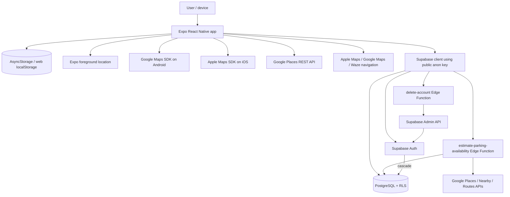
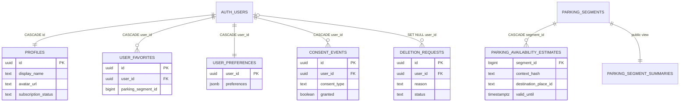
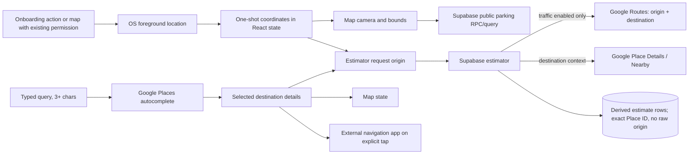
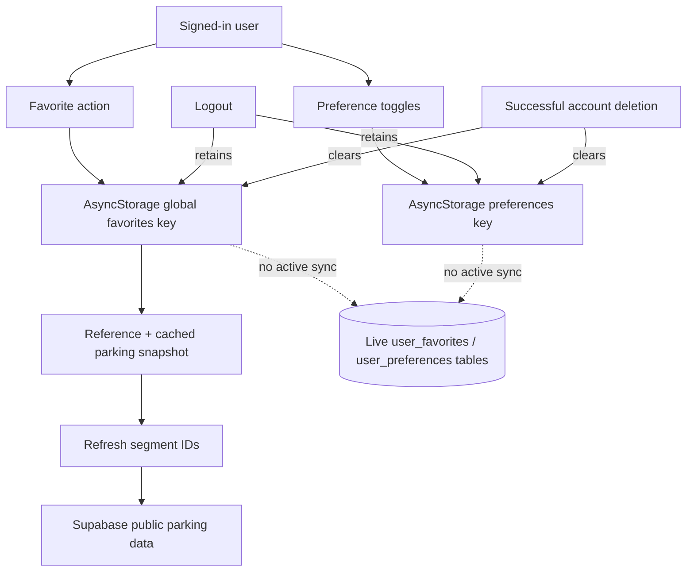
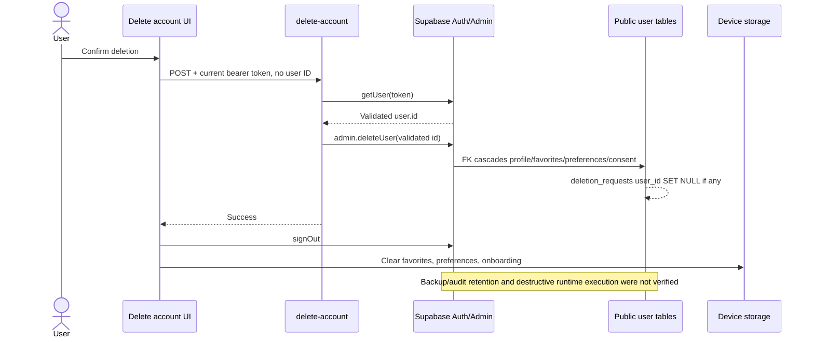

# WhiteChocolate Security & Data Handling Audit

**Audit date:** 2026-08-18

**Repository:** `Kara0410/WhiteChocolate`

**Branch and commit:** `master` at `32e928bd8e4a8391f429e07245fe005a5cead64b`
**Overall Security Posture:** **NEEDS ATTENTION**

This document is a point-in-time technical security and privacy review. Evidence is labelled as **VERIFIED DEPLOYED**, **VERIFIED IN REPOSITORY**, **LIKELY / INFERRED**, or **UNVERIFIED**. A repository migration or function is not described as deployed unless the live project was checked.

## 1. Executive Summary

WhiteChocolate is an Expo/React Native parking application backed by Supabase. It currently handles account identity, Supabase sessions, precise foreground location, place searches, favorite parking locations, preferences, onboarding state, and parking-estimation context. Most user preferences and favorites live only on the device. Supabase stores account records and the parking dataset; live user-sync tables exist but the current app does not use them for favorites or preferences.

The strongest protections are real and important. **VERIFIED DEPLOYED:** every current user-owned public table has RLS with ownership checks, a user cannot claim another user's `user_id`, subscription fields are not client-writable, and account deletion derives the target identity from the authenticated token rather than a client-provided ID. Service-role credentials were found only in server-side Edge Functions. **VERIFIED IN REPOSITORY:** location is foreground-only, one-shot rather than continuously watched, and is not saved as location history. No production path logging passwords, tokens, email addresses, or raw user coordinates was found.

Two issues deserve priority before a public launch:

1. The parking estimator accepts the normal public Supabase client credential without requiring an authenticated user. A caller can vary estimator context to force service-role cache writes and up to three Google-billed provider calls per cache miss. Crafted estimates can also become the newest public summary for 15–45 minutes.
2. OAuth and password-recovery callbacks use bearer tokens in the custom URI scheme `whitechoclate://`. The OAuth callback is not bound to a locally initiated transaction. Another installed application capable of claiming the same scheme could intercept tokens, and an unsolicited valid callback can replace the signed-in session.

Other material risks are unencrypted native session persistence in AsyncStorage, cross-account disclosure of device-global favorites on a shared device, indefinite estimator-cache retention, a replayable client-side Google Places REST key, a live six-character password minimum that can bypass the app's eight-character check, deletion without recent-authentication proof, and confirmed vulnerable packages in the Expo 54 build/tooling dependency tree.

No Critical finding was confirmed. This rating does not mean the application is broadly insecure: the deployed database authorization model is comparatively strong. It means the exposed Edge Function and mobile auth callback design need attention, and several privacy and hardening gaps should be resolved before production growth.

## 2. Audit Scope

### Inspected

- The complete tracked repository, including root configuration, `src/`, tests, `supabase/functions/`, all migrations, documentation, lockfile, and relevant generated native configuration.
- All 91 locally reachable Git commits and refs for removed storage, obsolete vehicles, auth changes, generated bundles, and committed credentials.
- Current ignored environment-variable **names and classifications**. Secret values were not copied into this report.
- Existing tests, lint, TypeScript checking, dependency audit, and installed dependency paths.
- **VERIFIED DEPLOYED:** linked Supabase project status, migration history, public/auth schemas, tables, views, row counts, RLS flags, policies, grants, functions, triggers, foreign keys, auth settings, deployed Edge Function metadata/source, and safe invalid-input requests.
- Current Expo 56 documentation, Supabase React Native/deep-link/PKCE guidance, and RFC 8252 as the 2026 practice baseline. The application itself is presently Expo 54.

### Commands and methods

Representative read-only commands included `rg`, `git status`, `git log`, `git grep` against historical trees, `npm test`, `npm run lint`, `npx tsc --noEmit`, `npm audit --omit=dev --json`, `npm ls`, Expo configuration inspection, Supabase CLI listing/download commands, and read-only PostgreSQL catalog queries through the linked Supabase Management API. Deployed function files were downloaded to a temporary directory, hashed against repository source, and removed after comparison. The two live function probes used deliberately invalid bodies so they could not create or delete data.

### Verification results

| Check | Result | Security relevance |
|---|---|---|
| `npm test` | PASS — 265/265 tests | Supports validation/error-handling conclusions; tests are not proof of authorization. |
| `npm run lint` | PASS | No lint failure affected the review. |
| `npx tsc --noEmit` | PASS | Current TypeScript sources type-check. |
| `npm audit --omit=dev --json` | FAIL — 32 affected production-tree package entries: 1 critical, 17 high, 14 moderate | Discussed in SEC-009; most confirmed paths are Expo CLI/Metro/build tooling. |
| `npx expo-doctor` | UNVERIFIED — first run hit a sandbox/cache error; approved retry did not complete and was terminated after several minutes | No conclusion is drawn from this command. |
| Live migration comparison | PASS — all 12 repository migration versions appear applied | Does not imply every base object is reproducible from these migrations; see Database Architecture. |
| Deployed function source comparison | PASS — both deployed functions and shared files matched repository hashes | Deployment state and reviewed source are aligned at audit time. |

### Could not be verified

Google Cloud key restrictions, quotas, billing alerts, and API abuse history; EAS-hosted secret inventory and a store release artifact; native runtime packet capture; physical-device backup/log extraction; Supabase backup and platform-log retention; provider-side Google/Apple SDK telemetry; destructive account-deletion behavior; live cross-user attack tests; and complete end-to-end signup/reset/OAuth mail flows. These are explicitly listed again in section 22.

## 3. Current Architecture



**VERIFIED IN REPOSITORY:** the app makes direct Supabase and Google Places calls. Navigation is handed to an installed external maps application. The estimator and deletion functions use service-role clients only inside Deno Edge Functions (`supabase/functions/estimate-parking-availability/index.ts:78-104`, `supabase/functions/delete-account/index.ts:33-60`).

**VERIFIED DEPLOYED:** `delete-account` v2 and `estimate-parking-availability` v6 were active with gateway JWT verification enabled, and their deployed source matched the repository. Gateway verification alone does not mean a user is signed in: the bundled anon JWT reaches the estimator handler.

## 4. User Data Inventory

Sensitivity is an engineering assessment, not a legal classification. “Local” includes transient React state unless persistence is named.

| Data | Collected From | Why | Local | Backend | Database | Third Party | Sensitive? | Retention |
|---|---|---|---|---|---|---|---|---|
| Email | User input; OAuth provider | Account identity/login | Form state; included in auth session/user object | Supabase Auth | `auth.users`, provider identity metadata | Supabase; Google during Google OAuth | Yes — direct identifier | Supabase account lifetime; backups/audit retention UNVERIFIED |
| Password | User input | Email signup/login/reset | Form state only; no app persistence found | Sent over TLS to Supabase Auth | Managed by Auth as a password hash, not app tables | Supabase | Highly sensitive | Auth-controlled; plaintext retention not found |
| Supabase user ID | Supabase Auth | Ownership/session state | Session/context memory; persisted within session | Supabase Auth and RLS | `auth.users`; `profiles.id`; user-table `user_id` | Supabase | Pseudonymous identifier | Account lifetime; cascades described in section 15 |
| Display name | OAuth/user metadata or email local-part fallback | UI greeting/profile mapping | Auth user/context and session metadata | Supabase Auth metadata; profile trigger can derive it | `auth.users.raw_user_meta_data`; `profiles.display_name` | Supabase; Google if OAuth supplies it | Personal | Account lifetime |
| Avatar URL | OAuth user metadata | UI account profile | Auth context/session metadata | Supabase Auth metadata | `auth.users.raw_user_meta_data`; `profiles.avatar_url` | Supabase and the avatar host when loaded | Personal | Account lifetime/provider-controlled |
| OAuth provider identity | Google OAuth | Authentication | Callback/session state | Supabase Auth | `auth.identities` and Auth metadata | Google and Supabase | Yes | Auth account lifetime |
| Access token, refresh token, session | Supabase Auth | Maintain login | **Persisted** in AsyncStorage on native; browser localStorage on web | Supabase Auth validates/rotates | Auth session/refresh-token tables | Supabase | Highly sensitive bearer credentials | Until sign-out, deletion, expiry/revocation, clear-data, or uninstall; no inactivity/time-box live |
| OAuth/recovery callback token or code | Deep link/browser callback | Complete OAuth/reset | URL and transient callback state; tokens become persisted session | Supabase Auth | Session records after exchange/set | OS/browser, Supabase, Google for OAuth | Highly sensitive | URL lifecycle transient; resulting session persists |
| Foreground location permission/status | OS | Decide whether location can be used | Hook state; OS permission store | No app backend transmission | None in app DB | Apple/Google OS platform | Privacy-related | OS-controlled; hook state for runtime |
| Precise GPS latitude/longitude | Device GPS / last-known fix | Center map; parking and optional traffic context | React state/refs, at most 10-second hook reuse; no app persistence found | Bbox/viewport reaches Supabase queries; precise origin reaches estimator when used | Raw origin is not stored in estimator table | Google Routes only when traffic is enabled; map SDK may process viewport | Sensitive location | Memory only in app; provider/platform retention UNVERIFIED |
| Map camera/region and query bounds | Gestures or GPS-centered map | Load visible parking | React state; dev logs | Sent to public Supabase parking RPC/query and estimator | Not retained as user history; affects generated estimates | Supabase | Approximate/precise location context | Request/log lifecycle; dev logs may persist externally |
| Search query | User typing | Place autocomplete | Memory only; no history key found | Not sent to Supabase | None | Google Places REST | Potentially sensitive intention/location | App memory; Google retention UNVERIFIED |
| Search session token | Random client value | Group autocomplete/details billing session | Memory only | No | None | Google Places | Low alone | Runtime search session |
| Destination place ID, coordinates, title/address | Google result selected by user | Center map and contextual estimate | Memory only, except a selected parking result may enter a favorite snapshot | Sent to estimator | Place ID is stored per estimate; destination coordinates influence a hash but raw destination coordinates are not columns | Google; Supabase | Sensitive location/intention | Place ID/estimate context currently indefinite; local favorite until cleared/deletion |
| Selected parking segment | User tap / Supabase parking data | Show details/navigation/favorite | Memory | Public parking read | Public `parking_segments`; generated summary | Supabase; navigation provider if opened | Usually public, but user choice is behavioral | Selection memory-only unless favorited |
| Favorite segment reference | User action while signed in | Revisit parking | **Persisted** device-global key with entity ID/type/creation time | Segment IDs used to refresh public parking data; no cloud user sync | Live `user_favorites` exists but current app does not write it | Supabase receives IDs for public refresh | Behavioral/location preference | Persists across logout; cleared locally on deletion/manual clear/uninstall |
| Cached favorite parking snapshot | Public parking data at favorite time | Offline/fast rendering | **Persisted** with coordinates, label/street, metadata, price, capacity, availability and distance fields | Refreshed from Supabase public parking | Source data is public parking; no user association stored remotely by app | Supabase | Can reveal a user's frequented areas | Same as favorite key; snapshots updated during refresh |
| Preferences | User settings | Customize app | **Persisted** locally | No active sync | Live `user_preferences` exists but is unused by current frontend | None | Mostly low; consent-like flags are privacy-relevant | Persists across logout; manual clear/deletion/uninstall |
| Analytics/crash preferences | User toggles | Future consent/configuration | **Persisted** locally, default false | No | No active write to `consent_events` | No active analytics/crash provider found | Privacy choice | Same as preferences. **Preference exists, but no active collection was found.** |
| Onboarding state | User actions | Avoid repeating onboarding/tips | **Persisted** locally with version, completion time, skip-account and seen-tip fields | No | None | None | Low | Until account deletion cleanup, explicit utility clear, uninstall, or app version logic |
| Subscription/tier | Hardcoded app state and protected DB profile | Account feature display | Context reports `FREE` | Profile schema supports server value | `profiles.subscription_status` | Supabase | Financial/account attribute | Profile lifetime; current app does not consume or change DB value |
| Consent event fields | No active frontend source found | Schema prepared for consent history | No | No active call | `consent_events`: type, version, granted, metadata, time | Supabase if implemented later | Privacy/legal | Cascades on user deletion; table live and empty at audit |
| Deletion reason/request status | No active frontend source found | Schema prepared for deletion workflow | No | Current deletion function does not use it | `deletion_requests` with nullable user ID, reason/status/time | Supabase if implemented later | Personal/account event | `user_id` becomes null on account deletion; other fields retained; table live and empty |
| Estimator request context | App-derived bbox, destination, origin, time, timezone, traffic flag | Generate parking availability | Memory and bounded in-memory request caches | Edge Function receives full body | Derived estimate/cache fields stored | Supabase; Google server APIs as described below | Location/intention context | Request transient; derived cache records currently indefinite |
| Estimator result | Supabase/Google-derived heuristic | Display predicted availability | Memory | Returned by Edge Function/public summary | `parking_availability_estimates` | Supabase | Not directly personal | No cleanup found; validity is 15–45 minutes but rows remain |
| Vehicle nickname/license plate/active vehicle | **Not currently collected** | Historical feature only | Legacy storage key is deletion-only | No active flow | `user_vehicles` was dropped and is absent live | None | License plates would be sensitive | Historical Git only; startup removes legacy device key |

No notification token, contact list, photo library data, microphone data, background location, payment card, advertising identifier, or current vehicle/license-plate input was found.

## 5. Simple User Data Guide

### When a user creates an account

The app normalizes the email, checks that the password is at least eight characters, and sends both directly to Supabase Auth (`src/services/account-auth.ts:19-85`). Supabase creates the Auth user. A deployed database trigger creates a `profiles` row from the new user ID and metadata (`supabase/migrations/20260712000100_harden_auth_profile_trigger.sql:7-33`). If Supabase returns a session, the app stores that session locally. The live server minimum is six characters, so a direct caller can bypass the app's stricter eight-character rule.

### When a user logs in

Credentials go directly to Supabase Auth. The returned user and session enter `AccountContext`; access and refresh tokens are persisted through the Supabase client's AsyncStorage adapter (`src/lib/supabase.ts:37-50`, `src/context/AccountContext.tsx:288-337`). The app maps display name/avatar from Auth metadata and currently reports the subscription as `FREE` (`src/utils/auth-user.ts:14-34`, `src/utils/account-state.ts:6-17`). It does not download the user's database favorites/preferences.

Google login opens a browser and returns to `whitechoclate://auth/callback`. The current flow accepts callback access/refresh tokens and calls `setSession` (`src/services/account-google-auth-core.ts:97-198`). Section 8 describes why the custom-scheme bearer-token flow needs hardening.

### When a user shares location

Onboarding can ask for foreground permission after a clear user action. The map also reads a location automatically on mount if permission was already granted. The app requests a high-accuracy one-shot fix, with a recent last-known fallback; it does not request background permission or continuously watch the user (`src/hooks/use-map-location.ts:50-100,265-289`). Coordinates stay in memory unless used in a request. Map bounds go to Supabase to load parking. Selecting a destination causes the precise origin to be included in the estimator request; Google Routes receives origin and destination only when traffic context is enabled.

### When a user searches for a place

After at least three characters and a short debounce, the text query goes directly from the device to Google Places with a random search-session token and a Munich location bias (`src/services/googlePlaces.ts:105-134`). Selecting a result sends its Place ID to Google for details. The app keeps search text/results in memory and has no search-history storage key.

### When a user favorites a parking spot

The UI requires an account, then saves the segment reference and a detailed public parking snapshot under one device-wide AsyncStorage key (`src/components/parking-map/ParkingBottomSheet.tsx:148-154`, `src/utils/favorite-parking-storage.ts:228-285`). No current cloud favorite write occurs. Favorites remain after logout. On a shared device, a later signed-in account can therefore see the preceding account's favorites.

### When a user changes preferences

The app saves the complete preference object locally. There is no active backend synchronization, even though a protected `user_preferences` table exists. Analytics and crash-reporting toggles default to false, and no corresponding SDK is installed or invoked. **Preference exists, but no active collection was found.**

### When a user uses parking estimation

The app sends visible bounds, destination context, current time/timezone, traffic choice, and—when available—the user's origin to the Supabase estimator (`src/utils/parking-estimator-request.ts:128-146`). The Edge Function reads parking segments, may ask Google for destination category/opening state, nearby demand, and traffic, and stores derived estimates using the service role. It stores the destination Place ID but not raw origin coordinates. The function currently treats a normal anonymous client token as sufficient.

### When a user logs out

Supabase invalidates the local session and the account context is cleared (`src/context/AccountContext.tsx:522-551`). The local favorites and preferences intentionally remain (`src/app/(tabs)/account/profile.tsx:66-68`). Onboarding also remains. This is convenient for a single-user phone, but unsafe for multiple accounts sharing the same app data.

### When a user deletes their account

The app invokes `delete-account` without supplying a user ID. The function validates the bearer token with `getUser()` and asks the Supabase Admin API to delete only that returned user (`supabase/functions/delete-account/index.ts:9-61`). Database foreign keys cascade current user-owned rows. The app then signs out and clears favorites, preferences, and onboarding (`src/app/(tabs)/account/delete.tsx:53-68`). The function does not currently create a `deletion_requests` row and does not require a recently verified password/OAuth login.

## 6. Frontend Data Handling

### React state and contexts

- `AccountContext` owns the current Auth user, session lifecycle, account actions, and a hardcoded free subscription. Authorization is ultimately enforced by Supabase, not by the context.
- `FavoriteParkingContext` hydrates the single global local key at app start, performs local mutations, and refreshes referenced segments from the public parking service (`src/context/FavoriteParkingContext.tsx:56-82,210-260`).
- Preference and onboarding modules serialize versioned records to AsyncStorage.
- Search query/results, selected destination, map camera, GPS fix, selected parking, request coordination, and estimator responses remain in React state/refs. In-memory estimator request maps evict over 16 entries (`src/hooks/use-parking-map-data.ts:191-205`, `src/utils/parking-estimator-request.ts:153-178`).

### Synchronization reality

`src/services/sync/sync-manager.ts:77-90` is a Phase 4A shell whose remote snapshot is an empty placeholder. Merge utilities/tests do not constitute network synchronization. Repository-wide call inspection found no current frontend CRUD against `profiles`, `user_favorites`, `user_preferences`, or `consent_events`. Therefore:

- favorites: local-only user preference; public segment data is refreshed from Supabase;
- preferences: local-only;
- profile: created by database trigger, but not read/updated by the app;
- consent: schema exists, but no events are recorded by the app;
- subscription: server-protected schema exists, but UI uses a local constant.

### Navigation

Opening directions sends the chosen parking destination coordinates and label to an installed Apple Maps, Google Maps, or Waze app, with Google Maps web as fallback (`src/utils/openParkingNavigation.ts:55-146`). WhiteChocolate does not explicitly place the user's origin in that URL; the external navigation app may use its own permission and account state.

## 7. Local Storage Map

| Storage Key | Data | Source File | Sensitive? | Authenticated/Guest | Deleted When | Security Notes |
|---|---|---|---|---|---|---|
| `sb-<project-ref>-auth-token` (Supabase default) | Session JSON including access token, refresh token, expiry and user metadata | `src/lib/supabase.ts:37-50`; Supabase client default in `node_modules/@supabase/supabase-js/src/SupabaseClient.ts:323-328` | **Yes — bearer tokens and identity** | Authenticated | Supabase sign-out, account deletion sign-out, clear app data/uninstall; server revocation/expiry | AsyncStorage is not encrypted. Web uses localStorage. See SEC-004. |
| `@white-choclate/preferences/v1` | Analytics, crash reporting, dark mode, haptics, language, notifications, parking reminders, units | `src/utils/preferences-storage.ts:6-18,61-99` | Low to moderate privacy | Guest or authenticated | Manual “clear local data,” successful account deletion cleanup, clear app data/uninstall | Global to the installation; persists across logout. No cloud sync. |
| `@white-choclate/favorites/v1` | Segment entity ID/type/created time and cached parking snapshot | `src/utils/favorite-parking-storage.ts:12-21,228-285`; `src/types/parking-domain.ts:172-175` | **Yes — behavioral/location preferences** | UI mutation requires auth; storage itself is installation-global | Manual clear, successful account deletion cleanup, clear app data/uninstall | Persists across logout and is not user-namespaced. See SEC-005. |
| `@white-choclate/onboarding/v1` | Version, completion/timestamp, skipped-account flag, seen tips | `src/utils/onboarding-state.ts:5-15,110-154` | Low | Guest or authenticated | Account deletion cleanup, utility clear, clear app data/uninstall | Not removed by logout or “clear local data” screen. |
| `@white-choclate/vehicles/v1` | Historical vehicle data, if an old install still has it | `src/utils/legacy-storage-cleanup.ts:3-14` | Potentially high if a license plate remains on a legacy install | Historical | Removed once by startup cleanup in `src/app/_layout.tsx:90-93` | No current read/write except deletion. Live table absent. |

No persistent keys for GPS history, search history, map camera, selected destination, estimator request cache, notification token, or account-deletion state were found.

The account “clear local data” screen accurately clears favorites and preferences only (`src/app/(tabs)/account/local-data.tsx:40-79`). It does not claim to sign out or reset onboarding. Successful account deletion additionally clears onboarding.

## 8. Authentication & Session Security

### Session lifecycle

1. The app creates one Supabase client from `EXPO_PUBLIC_SUPABASE_URL` and the expected public anon key. An accidental `/rest/v1/` URL suffix is stripped defensively (`src/lib/supabase.ts:9-22`).
2. Native uses AsyncStorage; web uses the Supabase browser default. `persistSession`, automatic token refresh, and foreground refresh management are enabled; URL session detection is disabled (`src/lib/supabase.ts:37-62`).
3. Startup calls `getSession()` and subscribes to Auth changes (`src/services/account-session.ts:17-60`). This is appropriate for hydration; database/Edge authorization still must validate the JWT.
4. Live refresh-token rotation is enabled with a 10-second reuse interval. **VERIFIED DEPLOYED:** there is no absolute session time-box, inactivity timeout, or single-session restriction.
5. Sign-out calls Supabase and clears account state, while keeping app preferences and favorites.

### Signup, login, and enumeration

The client normalizes email and requires eight password characters. **VERIFIED DEPLOYED:** Supabase requires only six, email confirmation is automatic, HIBP password screening is disabled, CAPTCHA is disabled, and anonymous Auth users are disabled. Because the anon credential is intentionally public, a caller can register directly against Auth and bypass client validation (SEC-007).

Login errors are mapped to a combined invalid-credentials response and password reset uses neutral wording. Duplicate signup errors can map to “account already exists” (`src/utils/account-errors.ts:154-165,269-281`), creating a **LIKELY / INFERRED** account-enumeration signal when the live Auth behavior returns that distinction. It was not tested against a known account because doing so would send mail or mutate authentication state.

### Password reset

Reset requests use the exact allowlisted `whitechoclate://auth/reset-password` redirect. The parser verifies scheme, host/path, and recovery type, then accepts either a PKCE `code` or legacy `access_token` plus `refresh_token`; it exchanges/sets a session, updates the password, and signs out when complete (`src/services/account-password-recovery-core.ts:90-147,150-300`). The input validation is careful, but accepting bearer tokens over an unverified custom scheme exposes them to interception (SEC-002).

### Google OAuth

Google is enabled live; Apple OAuth is not. The app opens a browser with `skipBrowserRedirect`, receives `whitechoclate://auth/callback`, and accepts access/refresh tokens (`src/services/account-google-auth-core.ts:97-198`). No explicit Supabase `flowType` is configured; the installed client defaults to implicit flow (`node_modules/@supabase/supabase-js/src/lib/constants.ts:40-45`). A callback with the expected route can be processed while signed out without proof that this app initiated the transaction (`src/utils/google-auth-callback.ts:42-58`, `src/app/auth/callback.tsx:93-103`). Use PKCE code exchange, locally stored state/transaction binding, and claimed HTTPS app/universal links in line with [Expo linking guidance](https://docs.expo.dev/linking/into-your-app/), [Supabase PKCE guidance](https://supabase.com/docs/guides/auth/sessions/pkce-flow), and [RFC 8252](https://www.rfc-editor.org/info/rfc8252/).

### Authorization properties

- Client-supplied user IDs do not authorize deletion; the backend uses the validated Auth user.
- Public-table RLS, not frontend state, protects user records.
- Profile entitlement/subscription columns are not client-writable, and no upgrade implementation was found (`src/context/AccountContext.tsx:611-618`).
- The estimator is the exception: its handler does not require a signed-in user even though it uses privileged resources.

## 9. Backend / Edge Functions

### `delete-account`

**Deployment:** **VERIFIED DEPLOYED**, ACTIVE v2, `verify_jwt = true`, deployed source hash matched repository.

| Property | Finding |
|---|---|
| Purpose/caller | Authenticated account deletion from `src/services/account-deletion.ts:20-38` |
| Authentication | POST + Bearer required; creates a user-scoped client and calls `auth.getUser(token)` (`supabase/functions/delete-account/index.ts:9-46`) |
| Authorization | Admin deletion is called with only `user.id` returned by Auth; request body cannot choose another account |
| Accepted input | No business payload or user ID |
| Service role | `SUPABASE_SERVICE_ROLE_KEY` read only in the function and used for `auth.admin.deleteUser` (`:47-60`) |
| Database effects | Auth user deletion; public user rows cascade; Auth-internal cleanup is platform-managed |
| Third parties | Supabase only |
| Response | Success or structured authorization/server errors |
| Rate limiting | No application limiter; a valid account can delete only itself |
| Logging | No tokens/user records logged in source |
| Main risk | No recent-authentication/step-up requirement before an irreversible action (SEC-008) |

A safe live request with the anon credential and no user session returned 401, confirming handler-level user validation. Actual deletion was not tested because it is destructive.

### `estimate-parking-availability`

**Deployment:** **VERIFIED DEPLOYED**, ACTIVE v6, `verify_jwt = true`, deployed source/shared-file hashes matched repository.

| Property | Finding |
|---|---|
| Purpose/caller | Contextual estimates from `src/services/parkingAvailabilityEstimator.ts:172-183` |
| Authentication | Gateway requires a JWT, but the handler never calls `getUser()` or distinguishes the public anon JWT (`supabase/functions/estimate-parking-availability/index.ts:78-104`) |
| Accepted input | Bounds, destination coordinates/place ID, optional origin, requested time, timezone, traffic flag |
| Validation | Finite/ranged coordinates, ordered global bounds, max 10 km span/25 km², exact timezone/boolean, parseable time, and maximum 500 segments (`supabase/functions/_shared/parking-estimator-request.ts:3-5,49-69,87-167`; function `:105-130`) |
| Validation gaps | Place ID is trimmed/type-checked but lacks length/format/coordinate consistency; requested time has no acceptable past/future window |
| Database access | Service-role reads parking/cache and upserts up to 500 estimates per cache miss (`index.ts:105-177,217-250`) |
| External APIs | Up to Google Place Details, Nearby Search, and Routes depending on context (`supabase/functions/_shared/parking-demand-context.ts:130-165,181-226,235-339`) |
| User data sent | Destination Place ID/coordinates; origin and destination coordinates reach Routes only when traffic is enabled |
| Stored fields | Segment/context/version, destination Place ID, derived category/open/traffic/factors, generated/created/valid timestamps; not raw origin |
| Rate limiting | No application-level per-user/IP quota found |
| Logging | Provider status, counts, latency and DB error codes; no raw coordinates, Place IDs, user IDs, or secret values found |
| Main risks | Anonymous billed-call/write amplification and public estimate poisoning (SEC-001); indefinite context retention (SEC-006) |

A safe live request containing an empty body and the public anon credential reached handler validation and returned `400 INVALID_BOUNDS`. This proves the normal guest credential reaches the privileged path; the rejected body did not invoke providers or write rows.

### Function secrets and dependency control

Both functions read Supabase server credentials from Deno environment variables. The estimator also reads `GOOGLE_MAPS_SERVER_API_KEY`. No value is in tracked source or referenced by Expo client code. `delete-account/index.ts:1` imports floating `https://esm.sh/@supabase/supabase-js@2`, whereas `deno.lock` locks the exact 2.109.0 URL used elsewhere. Pinning and locking this dependency would improve reproducibility; this is included as a roadmap hardening item rather than elevated to a standalone vulnerability.

## 10. Database Architecture

### Deployed schema comparison

**VERIFIED DEPLOYED:** the linked project was healthy in `eu-west-3` on PostgreSQL 17.6 at audit time. All 12 repository migration IDs from `20260703000100` through `20260723000100` were present remotely. Early migrations contain “DRAFT/do not apply” comments, but they are in fact applied; those comments are stale.

`user_vehicles` was created historically (`supabase/migrations/20260703000200_auth_foundation_user_data.sql:8-68`) and dropped later (`supabase/migrations/20260712000300_remove_user_vehicles.sql:1-3`). It is absent from the live schema and active TypeScript types. Parking zones were likewise removed by `20260722000100_remove_parking_zones.sql`. Do not treat either as current architecture.

One reproducibility limitation remains: repository migrations assume an existing/imported `parking_segments` base table rather than containing its original create statement. The live table was inspected, but a blank-database rebuild from this repository alone was not proven.



### Current tables and views

| Table/resource | Purpose | Personal Data? | User Identifier | RLS Enabled | anon Access | authenticated Access | service_role/backend Access | Retention/Delete Behavior |
|---|---|---|---|---|---|---|---|---|
| `auth.users` and Auth identity/session tables | Supabase identity and sessions | Yes | Auth user ID/email | Yes in live Auth schema | Auth API only | Own session through Auth API | Auth admin/backend | Platform-managed deletion/retention; backup/audit retention UNVERIFIED |
| `profiles` | Display/avatar/subscription profile | Yes | `id` | Yes | None | Own SELECT/INSERT/UPDATE; no direct DELETE | Full/bypass RLS | FK CASCADE from Auth user |
| `user_favorites` | Prepared cloud favorites | Yes/behavioral | `user_id` | Yes | None | Own SELECT/INSERT/UPDATE/DELETE | Full/bypass RLS | FK CASCADE; live row count 0; current app unused |
| `user_preferences` | Prepared cloud preferences JSON | Yes/preferences | `user_id` | Yes | None | Own SELECT/INSERT/UPDATE/DELETE | Full/bypass RLS | FK CASCADE; live row count 0; current app unused |
| `consent_events` | Append-only consent history | Yes/privacy | `user_id` | Yes | None | Own SELECT/INSERT; no UPDATE/DELETE | Full/bypass RLS | FK CASCADE; live row count 0; current app unused |
| `deletion_requests` | Prepared deletion workflow/audit | Yes | Nullable `user_id` | Yes | None | Own SELECT/INSERT; pending-to-cancelled status update only | Full/bypass RLS | User ID becomes null on account deletion; reason/status retained; live row count 0; current function unused |
| `parking_segments` | Public/non-user parking geometry and metadata | No, public parking data | None | Yes | SELECT and public RPC | SELECT and public RPC | Full | 13,340 live rows; operational dataset |
| `parking_availability_estimates` | Derived estimator cache | Destination context can be sensitive | No user ID | Yes | None directly | None directly | Service-role SELECT/INSERT/UPDATE/DELETE | 3,409 live rows; validity expires but no deletion job found |
| `parking_segment_summaries` view | Public segment + newest unexpired estimate | No direct user ID; derived context affects output | None | View | SELECT | SELECT | Full | Reflects base/estimate data |
| `spatial_ref_sys`, `geography_columns`, `geometry_columns` | PostGIS metadata | No app user data | None | Extension/system semantics | Metadata read | Metadata read | Full | Extension-managed |

Live profile count was 1; all four prepared user feature/compliance tables had 0 rows. Counts are operational evidence only and must not be used as a promise of future emptiness.

### Functions and triggers

- `handle_new_user` is a `SECURITY DEFINER` trigger with a constrained search path and creates the matching profile. The hardened migration is `20260712000100_harden_auth_profile_trigger.sql:7-33`.
- `fetch_parking_cells` is the final six-argument public `SECURITY DEFINER` RPC. Its live search path is `public, extensions, pg_temp`; identifiers are schema-qualified and user input is used as typed parameters, not dynamic SQL (`supabase/migrations/20260723000100_parking_runtime_regression_repair.sql:6-42,224-240`). `CREATE` on the public schema was not available to anon/auth roles.
- Live triggers and foreign keys matched the final migrations.

## 11. RLS & Authorization Matrix

**VERIFIED DEPLOYED** from live catalog policies and grants:

| Resource | anon | authenticated-own | authenticated-other | service_role/backend |
|---|---|---|---|---|
| `profiles` | Denied | SELECT/INSERT/UPDATE where `id = auth.uid()` | Denied | Full; subscription fields backend-controlled |
| `user_favorites` | Denied | CRUD where `user_id = auth.uid()` | Denied; `WITH CHECK` prevents claiming another ID | Full |
| `user_preferences` | Denied | CRUD where `user_id = auth.uid()` | Denied; `WITH CHECK` prevents claiming another ID | Full |
| `consent_events` | Denied | SELECT/INSERT own; append-only to client | Denied; `WITH CHECK` prevents claiming another ID | Full |
| `deletion_requests` | Denied | SELECT/INSERT own; only pending-to-cancelled status update | Denied; column grant limits client update to status | Full |
| `parking_segments` | Public SELECT/RPC | Public SELECT/RPC | Not user-owned | Full |
| `parking_availability_estimates` | No direct access | No direct access | No direct access | Full; estimator writes |
| `parking_segment_summaries` | Public SELECT | Public SELECT | Not user-owned | Full |
| `delete-account` | Gateway token alone insufficient; handler rejects non-user | Deletes authenticated caller only | Cannot select another ID | Admin API deletes validated user |
| `estimate-parking-availability` | **Allowed with normal anon JWT** | Same as anon | No ownership concept | Function internally uses service role |

Conceptual User A/User B tests pass from the policy definitions: User A cannot read, update, or delete User B's user-table rows, and cannot insert/update a row claiming User B's ID. A destructive or data-creating cross-user live test was not performed.

The live database grants `anon`/`authenticated` broader table privileges on `parking_segments` than the migration's intended SELECT grant (`supabase/migrations/20260722000100_remove_parking_zones.sql:499-500`). RLS has no INSERT/UPDATE/DELETE policies, so direct writes remain denied. This is still least-privilege drift (SEC-011).

## 12. Location Privacy

### Complete lifecycle

```text
User action in onboarding ──► foreground permission request
Previously granted permission + map mount ──► one-shot high-accuracy GPS fix
                                          └─► recent last-known fallback
                                                     │
                                                     ▼
                                           React hook/state only
                                             │            │
                                      map camera/bbox      precise origin
                                             │            │
                                             ▼            ▼
                                      Supabase public   estimator Edge Function
                                      parking query       │
                                                          ├─ not stored raw
                                                          └─ Google Routes only
                                                             if traffic enabled

Typed search ──► Google Places autocomplete ──► selected destination
                                                    │
                                                    ├─ map state
                                                    ├─ estimator/Supabase
                                                    └─ external navigation app
```

1. **Permission timing:** onboarding asks after user interaction (`src/app/onboarding.tsx:705-730,958-967`). The map does not prompt silently, but if permission is already granted it resolves an initial camera location on mount (`src/app/(tabs)/map.tsx:44-52`, `src/hooks/use-map-location.ts:265-289`).
2. **Scope:** foreground coarse/fine permissions only; no background permission or background task appears in Expo config/source.
3. **Precision/frequency:** active map hook asks for high accuracy, one fix, not a watcher (`src/hooks/use-map-location.ts:50-68`). It can fall back to a fix at most two minutes old and within 500 m accuracy (`:11-14,76-87`) and reuses an in-memory location for 10 seconds.
4. **Local storage:** coordinates, camera, destinations, and searches are not written to AsyncStorage. Development-only map diagnostics can log coordinates (section 16).
5. **Supabase:** camera bounds go to public parking queries. When contextual estimation runs, exact origin is always serialized if available—even with traffic disabled (`src/utils/parking-estimator-request.ts:128,135-146`). The server does not store raw origin and ignores it for provider calls unless traffic is enabled. Sending unused origin is SEC-010.
6. **Google:** typed search goes to Google Places with a fixed Munich bias, not the user's GPS. Google details receives Place ID. The Edge Function sends destination context to Google Place Details/Nearby and sends exact origin/destination to Routes when traffic is enabled. Android's native map is Google Maps.
7. **Apple:** iOS uses Apple Maps for the native map. Selecting Apple Maps navigation sends the parking destination. Provider SDK/app metadata and retention are UNVERIFIED.
8. **Guests:** guests can grant location, browse public parking, search Google, and invoke estimation. Favorite mutation is gated behind an account in the UI.

`src/hooks/useLocation.ts` contains a balanced-accuracy one-shot implementation, but repository-wide reference inspection found no active caller. The lifecycle above is based on the actually used `use-map-location` hook, not the obsolete/unused filename.

The settings copy says location is requested only from map actions (`src/hooks/use-location-permission-status.ts:53`); automatic one-shot acquisition on a map mount with pre-existing permission is close to, but not literally, that promise. Clarify this in privacy text.

## 13. Third-Party Data Sharing

| Third Party | Data | Reason | User Trigger | User Identification? | Location Data? | Secret/API Key Handling |
|---|---|---|---|---|---|---|
| Supabase Auth | Email/password, OAuth identity, user/session tokens, metadata | Account lifecycle | Signup/login/reset/OAuth/logout/delete | Yes | No direct GPS in Auth | Public anon client key expected; service role server-only |
| Supabase Database/API | Parking bounds/IDs, public results; user tables if future sync is implemented | Parking data and prepared user storage | Map/favorite refresh; current user sync inactive | Public requests may carry session JWT | Bounds; precise origin/destination in estimator request | TLS client using public anon key; RLS required |
| Supabase Edge Runtime | Deletion bearer token; estimator body | Privileged account deletion and estimation | Delete action / destination estimation | Yes for deletion; estimator handler does not resolve user | Yes for estimator | Service role in Deno env only |
| Google OAuth | OAuth identity/authorization metadata | Sign in with Google | Explicit Google login | Yes | Not from app flow | OAuth client configuration; no client secret found |
| Google Places REST from device | Typed query, session token, language/region; selected Place ID | Search/autocomplete/details | User types/selects a place | No app user ID; IP/device metadata likely provider-visible | Query/destination | `EXPO_PUBLIC_GOOGLE_PLACES_API_KEY` is client-visible and replayable; restrictions UNVERIFIED |
| Google Places/Nearby/Routes from Edge | Destination Place ID/coordinates/category context; exact origin/destination for traffic | Demand/traffic factors | Estimator cache miss; Routes only if traffic enabled | No Supabase user ID sent | Yes | Server key in Edge env; value not in source |
| Google Maps Android SDK | Map viewport, SDK/device/network metadata per provider implementation | Render native map | Open/use map | Provider-controlled | Map viewport | Client Maps key expected to be embedded; restrictions UNVERIFIED |
| Apple Maps iOS SDK | Map viewport and platform metadata per provider implementation | Render native map | Open/use map | Apple/device context possible | Map viewport | No app secret |
| Apple Maps / Google Maps / Waze app or Google Maps web | Parking destination coordinates and label | Turn-by-turn directions | Explicit navigation tap | External app/account dependent | Destination; external app may obtain origin independently | No WhiteChocolate secret |
| Expo/EAS | Source/build metadata and configured build credentials during cloud builds | Build/distribution | Developer build process, not normal runtime | Developer/project identity | No user GPS flow found | Hosted EAS inventory UNVERIFIED; `eas.json` contains no secret values |

No analytics, advertising, crash-reporting, payment, social SDK, or other telemetry provider was found in dependencies or active code. **Preference exists, but no active collection was found.**

## 14. Secrets & Environment Variables

No secret values are reproduced here.

| Variable | Client/Server | Expected Exposure | Risk / Finding |
|---|---|---|---|
| `EXPO_PUBLIC_SUPABASE_URL` | Client | Public | Expected endpoint; current local value has `/rest/v1/` suffix but code strips it |
| `EXPO_PUBLIC_SUPABASE_ANON_KEY` | Client | Public/publishable | Expected to be extractable; safety depends on RLS/function authorization |
| `EXPO_PUBLIC_GOOGLE_MAPS_ANDROID_API_KEY` | Client/build | Public in Android app | Expected embedded key; must have Android app/API restrictions and quotas, UNVERIFIED |
| `EXPO_PUBLIC_GOOGLE_MAPS_IOS_API_KEY` | Client/build | Public if used | Defined locally but no active source reference found; currently same material as Android, an unnecessary coupling |
| `EXPO_PUBLIC_GOOGLE_PLACES_API_KEY` | Client | Public in JS bundle and request header | Generic REST key is directly replayable for allowed Places calls; see SEC-003 |
| `SUPABASE_URL` | Edge/server | Endpoint, not a secret | Correct server scope |
| `SUPABASE_ANON_KEY` | Edge/server | Public credential, server env | Used to validate caller through a user-scoped client in deletion function |
| `SUPABASE_SERVICE_ROLE_KEY` | **Server only** | Must never be public | Correctly referenced only through `Deno.env`; no literal/client reference found |
| `GOOGLE_MAPS_SERVER_API_KEY` | **Server only** | Must never be public | Correctly referenced in estimator Edge code; no value in tracked source |
| `SUPABASE_ACCESS_TOKEN` | Developer/tooling only | Secret | Present in ignored local environment, absent from tracked source/history by exact-value check |

`.env` is ignored and has never been committed; `.env.example` contains names/placeholders only. `eas.json` contains profiles, not secret values. The lockfile uses HTTPS registry URLs with integrity hashes.

Git history does contain active Google client-key material: the Maps key was previously hardcoded in `app.config.ts`, and generated web export bundles contained the Places key plus expected public Supabase configuration. The Google values still match local client configuration by redacted equality checks. This does not make an intentionally client-visible key private; it does make provider restrictions and quotas essential. The historical `.tmp-*-export/` paths are not covered by the current `.gitignore` export patterns, so add a precise ignore/secret-scanning control after deciding which build artifacts should be retained.

No service-role value, Supabase tooling token, private key, OAuth client secret, database password, AWS/GitHub/Slack/Stripe token, or high-confidence JWT secret was found in the current tracked tree or reachable history.

## 15. Account Deletion & Data Retention

| Data category | Behavior after successful current deletion flow | Verification |
|---|---|---|
| Supabase Auth user/identities/sessions | Admin API deletes the validated Auth user; exact internal/audit/backup retention is provider-controlled | Function path VERIFIED DEPLOYED; backup/audit retention UNVERIFIED |
| `profiles` | FK `ON DELETE CASCADE` | VERIFIED DEPLOYED |
| `user_favorites` | FK `ON DELETE CASCADE`; current app has no rows/sync | VERIFIED DEPLOYED |
| `user_preferences` | FK `ON DELETE CASCADE`; current app has no rows/sync | VERIFIED DEPLOYED |
| `consent_events` | FK `ON DELETE CASCADE` | VERIFIED DEPLOYED |
| `deletion_requests` | `user_id` becomes null; reason/status/timestamps retained | VERIFIED DEPLOYED, but current function does not create a request |
| Local session | Post-delete sign-out clears Supabase persistence if cleanup completes | VERIFIED IN REPOSITORY |
| Local favorites/preferences/onboarding | Cleared after backend success; errors are surfaced as cleanup warnings | VERIFIED IN REPOSITORY (`src/app/(tabs)/account/delete.tsx:53-68`) |
| Search/GPS/map state | Memory-only and disappears with runtime lifecycle | VERIFIED IN REPOSITORY |
| Estimator cache/destination Place IDs | No user ID links them to an account; account deletion does not remove them | VERIFIED DEPLOYED/REPOSITORY; indefinite cleanup gap |
| Supabase backups/platform logs | No repository control or accessible retention evidence | UNVERIFIED; requires project backup/log retention configuration |
| Google provider records | WhiteChocolate cannot delete them through current code | UNVERIFIED; requires provider policy/DPA and any applicable deletion APIs |

The deletion target has a strong ownership design, but the irreversible operation accepts any currently valid session without recent-authentication proof. The deletion UI uses confirmation taps but that is not a cryptographic step-up. See SEC-008.

## 16. Logging & Debug Information

Repository-wide inspection found no production path that deliberately logs passwords, access/refresh tokens, full sessions, OAuth callback URLs, email addresses, license plates, service-role keys, or raw GPS coordinates.

- Account and app error normalizers log only in development and reduce errors to name/code/status/message (`src/utils/account-errors.ts:372-388,532-556`, `src/utils/app-errors.ts:250-268`). Token-like nested fields are omitted.
- Map/parking development diagnostics log camera center, bounds, region, and sample public marker coordinates (`src/components/parking-map/use-parking-marker-pipeline.ts:85-106,246-264`, `src/services/parkingSegments.ts:35-92`). These are guarded by `__DEV__`, but internal development clients and Metro/logcat can retain precise test-device location. Use synthetic/coarsened coordinates or structured redaction in internal builds.
- The deployed estimator logs provider status, counts, cache/write counts, latency, and database error codes (`supabase/functions/estimate-parking-availability/index.ts:116-118,162-166,242-247,273-298`). No raw coordinate, Place ID, user ID, API key, or request body logging was found.
- Account deletion does not log the bearer token or user record.

Production log transport, retention, access controls, and device vendor logging were not accessible and remain UNVERIFIED.

## 17. Security Findings

### SEC-001 — Public estimator permits billed-call amplification, privileged writes, and estimate poisoning

**Severity:** High

**Confidence:** High

**Status:** Verified

**Affected files:**

- `supabase/config.toml:3-7`
- `src/lib/supabase.ts:9-10,37-50`
- `src/services/parkingAvailabilityEstimator.ts:172-183`
- `supabase/functions/estimate-parking-availability/index.ts:78-130,148-186,217-250`
- `supabase/functions/_shared/parking-estimator-request.ts:3-5,127-149`
- `supabase/functions/_shared/parking-demand-context.ts:299-334`
- `supabase/migrations/20260722000100_remove_parking_zones.sql:264-278`

**Description:**

The gateway verifies that a JWT is structurally acceptable, but the handler never resolves an authenticated user or applies a quota. The intentionally bundled Supabase anon key is sufficient to reach it. On a cache miss the function uses the service role, can read a bounded set of up to 500 segments, can make Place Details, Nearby, and Routes calls using a billed server key, and upserts estimates. Caller-controlled Place IDs and timestamps allow many distinct contexts. The public summary view selects the newest non-expired snapshot without matching the requesting context.

**Attack / privacy scenario:**

An attacker extracts the normal public anon credential, repeatedly submits valid 25 km²-or-smaller bounds while varying `destination.placeId` and time context, and causes Google API spend plus up to 500 durable rows per request. A deliberately chosen context can become the newest estimate shown in the public parking summary for its 15–45 minute validity, reducing data integrity for ordinary users.

**Current protection:**

Gateway JWT verification is enabled. The parser validates numeric ranges, bounding-box order/size, timezone/boolean shape and a maximum of 500 segments. Valid cache hits suppress repeated provider work. Provider secrets remain server-side.

**Recommendation:**

Require a real authenticated user via `auth.getUser()` unless a deliberate guest entitlement is implemented; add per-user/IP/device rate limits, provider-call budgets, and monitoring; constrain Place ID length/format and requested-time window; bind/canonicalize destination identity; and ensure public summaries use an appropriate context or a separate trusted publishing path. Add idempotency/abuse tests before deployment.

### SEC-002 — OAuth and recovery bearer tokens use an interceptable, unbound custom-scheme callback

**Severity:** High

**Confidence:** High

**Status:** Verified

**Affected files:**

- `app.config.ts:14-35`
- `src/services/account-google-auth-core.ts:97-198,201-280`
- `src/services/account-password-recovery-core.ts:90-147,181-238`
- `src/utils/google-auth-callback.ts:42-58`
- `src/app/auth/callback.tsx:93-103`
- `src/lib/supabase.ts:37-50`
- `node_modules/@supabase/supabase-js/src/lib/constants.ts:40-45`

**Description:**

The app receives OAuth and legacy recovery access/refresh bearer tokens through `whitechoclate://` custom URLs. Custom schemes are not exclusively owned at the OS level. Google OAuth does not bind the returned callback to a locally stored initiating transaction/state, and the current signed-out callback route accepts an otherwise valid unsolicited callback. The Supabase client has no explicit PKCE `flowType`; the installed default is implicit.

**Attack / privacy scenario:**

A malicious app installed on the device registers the same custom scheme and intercepts an OAuth or recovery link, obtaining bearer tokens. Separately, an attacker can cause a victim to open a valid callback created for the attacker's account; without transaction binding, WhiteChocolate can replace the current local session, causing the victim's subsequent activity to occur in the wrong account. Intercepted recovery tokens can enable password reset/account takeover.

**Current protection:**

Callback parsers strictly check scheme, route and recovery type; Supabase validates the actual tokens; token values are not logged; and the live redirect allowlist is exact rather than wildcarded.

**Recommendation:**

Move native flows to authorization-code PKCE, accept code-only callbacks, store and verify one-time state/transaction data before exchange, reject unsolicited callbacks, and use claimed HTTPS universal/app links where possible. Treat custom-scheme fallback as lower assurance and test competing-scheme and login-CSRF cases.

### SEC-003 — Client-side Google Places REST credential is replayable outside the app

**Severity:** Medium

**Confidence:** High

**Status:** Verified

**Affected files:**

- `src/config/googleMaps.ts:1-3`
- `src/services/googlePlaces.ts:81-87,105-134,169-193`
- `app.config.ts:32-35`
- `.gitignore:6-10`

**Description:**

`EXPO_PUBLIC_GOOGLE_PLACES_API_KEY` is intentionally bundled and sent in `X-Goog-Api-Key` by generic REST requests. Anyone can recover and replay it for any provider operations allowed by its Google Cloud restrictions. Unlike a native SDK request, the shown REST request contains no Android package/certificate or iOS bundle identity proof. The same active key also remains in reachable historical web-export bundles. Google Maps client keys have similarly appeared in history, although embedded Maps SDK keys are normally public.

**Attack / privacy scenario:**

An attacker extracts the Places key from the JS bundle or Git history and scripts autocomplete/details traffic, consuming quota or causing cost/availability impact. If its API restrictions are broad, it may work against other enabled Google services as well.

**Current protection:**

No server secret is used by the client. The app uses search session tokens and limits UI requests with minimum query length/debounce. Provider-side API restrictions, application restrictions, quotas and billing alerts are UNVERIFIED.

**Recommendation:**

Verify and narrowly restrict each key to the required APIs, use separate per-platform/purpose keys, enforce quotas and billing alerts, and monitor anomalous use. For REST Places traffic that cannot be strongly app-bound, proxy through an authenticated/rate-limited backend or use an appropriate attested/native provider integration. Rotate exposed keys after restrictions are correct, and prevent temporary export directories from entering Git.

### SEC-004 — Native Supabase bearer sessions are stored in unencrypted AsyncStorage

**Severity:** Medium

**Confidence:** High

**Status:** Verified

**Affected files:**

- `src/lib/supabase.ts:3,37-50`
- `app.config.ts:14-35`

**Description:**

The Supabase client persists its session through AsyncStorage. The default session record includes access and refresh tokens and user metadata. AsyncStorage is application sandbox storage, not encrypted credential storage. A rooted/compromised device, debugger-accessible development environment, malware with elevated access, or recoverable device backup can expose the refresh token. The current local generated Android manifest permits backup by default; a signed release artifact and actual backup contents were not inspected.

**Attack / privacy scenario:**

An attacker extracts the AsyncStorage database from a compromised or backed-up device and reuses the refresh token. Because the live Auth project has rotation but no inactivity or absolute session time-box, the attacker may maintain access until revocation/reuse detection or logout.

**Current protection:**

OS application sandboxing, TLS, Supabase refresh-token rotation with a 10-second reuse interval, and logout revocation reduce risk. Supabase's current React Native quickstart still demonstrates AsyncStorage, so this is a defense-in-depth finding rather than evidence of a framework integration error.

**Recommendation:**

Evaluate an encrypted storage adapter suitable for potentially large session payloads—commonly a chunked/encrypted design using Expo SecureStore/Keychain/Keystore or an encrypted database—with migration and corruption recovery. Exclude sensitive storage from Android backup, minimize session duration consistent with usability, and test rotation/revocation. Expo SecureStore size/platform constraints must be handled rather than assuming one token blob always fits.

### SEC-005 — Device-global favorites disclose one account's parking choices to the next account

**Severity:** Medium

**Confidence:** High

**Status:** Verified

**Affected files:**

- `src/utils/favorite-parking-storage.ts:12,228-285`
- `src/context/FavoriteParkingContext.tsx:56-82,210-260`
- `src/components/parking-map/ParkingBottomSheet.tsx:148-154`
- `src/context/AccountContext.tsx:522-551`
- `src/app/(tabs)/account/profile.tsx:66-68`

**Description:**

The UI requires authentication to favorite a segment, but all accounts share `@white-choclate/favorites/v1`. Favorites hydrate independently of the current user and logout intentionally retains them. The record includes a detailed snapshot with coordinates/location metadata.

**Attack / privacy scenario:**

User A signs out from a shared phone or test device. User B signs in and sees User A's favorite parking locations, which may reveal home, work, routines, or sensitive destinations. User B can also alter the shared list.

**Current protection:**

The device OS normally isolates app data from other apps. Manual local-data clearing and successful account deletion remove favorites. There is no remote cross-user exposure because current cloud sync is inactive.

**Recommendation:**

Namespace local favorites by authenticated user ID, never load one user's namespace for another, decide and document guest behavior, and clear or securely detach user-specific state on logout/account switch. Add two-account device tests and a migration for the current global key.

### SEC-006 — Estimator context and destination Place IDs have no cleanup or retention limit

**Severity:** Medium

**Confidence:** High

**Status:** Verified

**Affected files:**

- `supabase/migrations/20260718000100_parking_availability_estimator.sql:9-25,46-69`
- `supabase/functions/estimate-parking-availability/index.ts:148-177,217-240`
- `supabase/functions/_shared/parking-estimator-context.ts:83-111`

**Description:**

The estimate table stores one record per segment, context hash and estimator version, including the exact caller-supplied destination Place ID and timestamps. `valid_until` controls cache reuse but no repository or deployed cleanup job deletes expired rows. Caller-controlled unique contexts can create up to 500 lasting rows per successful request. There were 3,409 live records at audit time.

**Attack / privacy scenario:**

Normal use accumulates a durable record of destination identifiers and generation times. An abusive caller varies Place IDs/context to grow the table without bound. There is no user ID, so direct attribution is limited, but destinations can still be sensitive and timestamps can reveal operational patterns.

**Current protection:**

Only the service role directly accesses the table; context hashes use SHA-256 and raw origin/destination coordinates are not stored as columns. Request bounds and segment count are capped.

**Recommendation:**

Define a short justified retention period, schedule deletion/partition expiry for stale rows, avoid storing raw Place IDs if a keyed/canonical derived value is sufficient, cap context cardinality, and monitor table growth. Align cleanup with documented privacy retention.

### SEC-007 — Live Auth permits passwords shorter than the app's stated minimum

**Severity:** Medium

**Confidence:** High

**Status:** Verified

**Affected files:**

- `src/services/account-auth.ts:19-85`
- `src/utils/account-errors.ts:154-165,269-281`

**Description:**

The app requires eight characters, but **VERIFIED DEPLOYED** Supabase Auth requires only six. The public anon credential allows direct API signup, so frontend validation is not an enforceable security control. Live HIBP password screening and CAPTCHA are disabled.

**Attack / privacy scenario:**

A user or automated client bypasses the mobile UI and registers a six- or seven-character password, increasing guessing and credential-stuffing risk relative to the product's intended policy.

**Current protection:**

Supabase hashes passwords, applies Auth rate limits, and refresh-token rotation is active. The client enforces eight for ordinary UI users. Email auto-confirm is enabled and reset request wording is neutral.

**Recommendation:**

Set the server minimum to at least the product minimum and prefer a modern longer minimum/passphrase-friendly policy. Consider breached-password screening and risk-appropriate bot controls. Keep client validation for usability, but treat server policy as authoritative.

### SEC-008 — Account deletion does not require recent authentication

**Severity:** Medium

**Confidence:** High

**Status:** Verified

**Affected files:**

- `src/app/(tabs)/account/delete.tsx:35-68`
- `src/services/account-deletion.ts:20-38`
- `supabase/functions/delete-account/index.ts:9-61`
- `src/utils/account-errors.ts:455-462`

**Description:**

Any valid current access token can invoke irreversible account deletion. The UI confirmation is not proof of recent password/OAuth authentication, and the function does not inspect authentication age or require a one-time confirmation. The error mapper contains a reauthentication message, but no backend path emits it.

**Attack / privacy scenario:**

An attacker who gains a persisted session—through an unlocked phone, token extraction, or callback interception—can permanently delete the victim's account and cascading user data without knowing the password or repeating OAuth.

**Current protection:**

The endpoint requires a valid user JWT, derives the exact target from `getUser`, accepts no client-selected user ID, and the UI asks for confirmation. The design prevents IDOR and mass deletion.

**Recommendation:**

Require recent authentication or a step-up challenge before issuing a short-lived deletion authorization. For email users, re-enter password; for OAuth, reauthenticate with the provider. Add replay protection and retain only the minimum legally/operationally justified deletion receipt.

### SEC-009 — Expo 54 dependency tree contains confirmed vulnerable build/tooling packages

**Severity:** Medium

**Confidence:** High

**Status:** Verified

**Affected files:**

- `package.json:11-30`
- `package-lock.json:8482-8483,9638-9639,12719-12720,12844-12845,14425-14426`

**Description:**

`npm audit --omit=dev` reported 32 affected dependency entries: 1 critical, 17 high, and 14 moderate. Concrete versions include `tar@7.5.16` through `expo@54.0.35 -> @expo/cli`, `postcss@8.4.49`, `image-size@1.2.1`, and affected `brace-expansion`, `fast-uri`, `js-yaml`, `nanoid`, `shell-quote`, `undici`, and `uuid` paths. The app is on Expo SDK 54 while SDK 56 is the requested 2026 baseline. npm's aggregate remediation crosses major SDK versions.

**Attack / privacy scenario:**

A malicious or malformed archive/CSS/image/build input, compromised package source, or developer tooling interaction can trigger denial of service or file-read/parsing issues during build/development. The audit did not establish direct remote reachability from ordinary app users into most affected CLI/Metro paths, so the application's finding is Medium rather than inheriting npm's Critical label.

**Current protection:**

The v3 lockfile pins HTTPS registry artifacts with integrity metadata; only normal package lifecycle scripts were present; tests/lint/types pass. No arbitrary user upload/build pipeline was found.

**Recommendation:**

Plan a supported Expo SDK upgrade with the exact versioned migration guidance, verify fixes using `npm audit` and dependency-path inspection, rebuild native projects, and regression-test auth/deep links/maps/location. Do not apply npm's force fix blindly. Add automated dependency review and a controlled build pipeline.

### SEC-010 — Precise origin is disclosed to Supabase when traffic context is disabled

**Severity:** Low

**Confidence:** High

**Status:** Verified

**Affected files:**

- `src/hooks/use-parking-map-data.ts:181-190,210-218`
- `src/utils/parking-estimator-request.ts:128,135-146`
- `src/services/parkingAvailabilityEstimator.ts:176-182`
- `supabase/functions/_shared/parking-demand-context.ts:328-334`

**Description:**

The request builder serializes a valid precise origin independently of `includeTraffic`. The Edge Function only uses origin for Google Routes when traffic is enabled and does not store or log raw origin. Sending it when traffic is off is unnecessary first-party location disclosure.

**Attack / privacy scenario:**

A user disables traffic context or uses a flow where it is false, but their exact device position still traverses Supabase infrastructure and could exist transiently in lower-level network/platform telemetry outside repository control.

**Current protection:**

TLS is used; no application DB column or function log contains raw origin; Google does not receive origin on the disabled path.

**Recommendation:**

Omit `origin` entirely unless traffic calculation is enabled and clearly disclosed. Add a request-shape test asserting absence, not merely that the server ignores it.

### SEC-011 — Live parking table grants are broader than repository intent

**Severity:** Low

**Confidence:** High

**Status:** Verified

**Affected files:**

- `supabase/migrations/20260722000100_remove_parking_zones.sql:499-500`

**Description:**

The final migration grants `SELECT` on `parking_segments` to anon/authenticated roles, but live catalog grants include broader table privileges. RLS is enabled and no client DML policy exists, so write attempts remain blocked. This is configuration drift and lost defense in depth, not a verified RLS bypass.

**Attack / privacy scenario:**

If a future policy is added too broadly or RLS is accidentally disabled, the excess underlying grants would immediately expand impact. The current layered control is less robust than the migration communicates.

**Current protection:**

RLS currently restricts anon/authenticated access to public SELECT behavior, and service-role access is appropriately privileged.

**Recommendation:**

Reconcile live grants with the intended SELECT-only model through a reviewed future migration, add catalog assertions to CI, and alert on RLS/grant drift. Do not change production grants without deployment review.

### SEC-012 — Development diagnostics include precise map coordinates

**Severity:** Low

**Confidence:** High

**Status:** Verified

**Affected files:**

- `src/components/parking-map/use-parking-marker-pipeline.ts:85-106,246-264`
- `src/services/parkingSegments.ts:35-92`
- `eas.json:7-12`

**Description:**

Development-only logs include camera-center coordinates, bounding boxes, current regions, and sample marker coordinates. The EAS configuration includes an internally distributed development client, so these logs can appear in Metro, device logs, screenshots, or developer support captures.

**Attack / privacy scenario:**

An internal tester uses the app from home or another sensitive location and shares a log bundle while troubleshooting, disclosing a precise or narrow location area.

**Current protection:**

Every identified coordinate log is guarded by `__DEV__`; no production logging path was confirmed. Marker samples themselves are public parking points, though camera/bounds can reflect the user.

**Recommendation:**

Remove or coarsen user-centered coordinates, use structured redaction by default, document safe support-log handling, and verify release bundles eliminate development branches.

### SEC-013 — Privacy/consent controls are placeholders rather than an operational consent record

**Severity:** Informational

**Confidence:** High

**Status:** Verified

**Affected files:**

- `src/constants/account-settings.ts:143-159,203-230`
- `src/app/(tabs)/account/privacy.tsx:3-8`
- `src/utils/preferences-storage.ts:9-18`
- `supabase/migrations/20260703000300_auth_foundation_compliance.sql:5-45`

**Description:**

Analytics and crash preferences exist locally and default off, but no collection SDK or network path was found. The privacy screen is a placeholder, the policy URL is not configured, no Terms/privacy version acceptance exists in active UI, and the deployed `consent_events` table is unused and empty. **Preference exists, but no active collection was found.**

**Attack / privacy scenario:**

There is no current analytics disclosure caused by these toggles. The risk arises if analytics/crash collection is later enabled and the UI preferences are mistaken for auditable, versioned consent or if users cannot obtain accurate notice about location and provider sharing.

**Current protection:**

Collection defaults are conservative and no telemetry SDK was found. A protected append-only consent schema is prepared for future use.

**Recommendation:**

Before activating telemetry, publish accurate notices, configure policy links, define consent/legal basis by data category and jurisdiction, record versioned choices only where required, make withdrawal effective, and verify SDK behavior through runtime traffic inspection. Obtain legal review.

## 18. Security Strengths

- **Correct deployed ownership enforcement:** all live user-owned public tables use `auth.uid()` checks for both visibility and row creation/update. No User A/User B IDOR was found.
- **Strong deletion target binding:** account deletion accepts no user ID and deletes only the user returned by Supabase Auth.
- **Service-role isolation:** no service-role/JWT secret value or client reference was found in the tracked app or Git history. Edge logs do not print secrets.
- **Server-controlled entitlement schema:** client grants exclude protected subscription fields; the unfinished upgrade UI cannot alter them.
- **Cascading user-data deletion:** profile, cloud favorites/preferences, and consent rows cascade from `auth.users`; retained deletion requests intentionally lose the user ID.
- **Foreground-only location:** no background location permission, watcher, or persisted search/location history exists. Recent-location fallback has explicit age/accuracy limits.
- **Estimator input bounds:** numeric/range validation, geographic area limits, and a 500-segment cap reduce individual-request abuse.
- **Exact live/repository alignment:** all 12 migrations were listed live, and both deployed Edge Function source trees hash-matched the reviewed repository.
- **No active tracking SDK:** analytics/crash preferences default false and no active collection was found.
- **Safe operational logging:** production-reachable application logs of tokens, email, passwords, raw location, or license plates were not found.
- **Obsolete vehicle removal:** `user_vehicles` is absent live, active types contain no vehicle model, and startup removes the legacy device key.
- **Healthy engineering checks:** 265 tests, lint, and TypeScript checking all passed.

## 19. Prioritized Risk Register

| Priority | Finding | Severity | Effort | Recommended Order |
|---|---|---|---|---|
| P0 — immediate | SEC-001 public estimator abuse/data integrity | High | Medium | 1 |
| P0 — immediate | SEC-002 custom-scheme implicit auth callbacks | High | High | 2 |
| P1 — before public launch | SEC-003 replayable Places REST key | Medium | Medium | 3 |
| P1 — before public launch | SEC-005 cross-account local favorites | Medium | Medium | 4 |
| P1 — before public launch | SEC-004 unencrypted persisted sessions | Medium | Medium/High | 5 |
| P1 — before public launch | SEC-006 indefinite estimator context retention | Medium | Medium | 6 |
| P1 — before public launch | SEC-007 server password minimum mismatch | Medium | Low | 7 |
| P1 — before public launch | SEC-008 deletion lacks step-up | Medium | Medium | 8 |
| P2 — important hardening | SEC-009 vulnerable Expo/build dependency tree | Medium | High | 9 |
| P2 — important hardening | SEC-010 unused location disclosure | Low | Low | 10 |
| P2 — important hardening | SEC-011 live grant drift | Low | Low | 11 |
| P2 — important hardening | SEC-012 development coordinate logs | Low | Low | 12 |
| P3 — future improvement | SEC-013 operational privacy/consent readiness | Informational | Medium | 13 |

There are no P0 Critical findings. Here “P0” means address immediately because of exposure and cost/account impact, not that severity has been inflated to Critical.

## 20. GDPR / Privacy Readiness

This is a technical readiness assessment, **not legal advice**.

### Data minimization

The implementation is comparatively restrained: no background tracking, search history, advertising ID, contacts, notification token, or active telemetry was found. Exact origin should nevertheless be omitted from traffic-disabled requests, favorite snapshots contain more public parking detail than may be necessary, and estimator Place IDs should have a documented short retention.

### Transparency and purpose

Users need plain-language notice that:

- Supabase handles account and parking requests;
- typed searches go directly to Google Places;
- destination context and, for traffic, origin/destination go through the estimator to Google;
- Google/Apple map SDKs and external navigation applications receive map/destination context;
- favorites/preferences are device-local and persist after logout;
- location may be read on map open when permission was already granted.

The current privacy screen and policy URL are not ready to supply that notice. Legal counsel should determine lawful bases, required disclosures, controller/processor roles, international-transfer terms, and whether location/destination context is personal data in each operating context.

### Consent

Analytics/crash toggles are not currently tied to collection. Do not claim consent records exist merely because a database table exists. If optional telemetry is introduced, the actual SDK must be disabled until the applicable choice, the choice/version must be auditable if required, and withdrawal must stop collection. Core location/search functionality may require a different lawful basis/permission model; legal review is required.

### Access, deletion, and retention

Account deletion covers current account-linked tables and local user state after backend success. It does not address provider records, backups, Auth audit retention, or anonymous estimator contexts. Define and publish retention schedules for Auth logs/backups, deletion receipts, estimator records, Edge logs, and provider data. Determine how a data-subject request can find context not keyed by user ID and whether such data is reasonably identifiable.

### Security of processing

RLS and server-bound deletion identity are strong foundations. Estimator abuse controls, safer callback/session handling, dependency maintenance, and operational monitoring are needed before describing the system as production-ready. Contracts/DPAs and subprocessor disclosures for Supabase, Google, Apple, and Expo/EAS require legal/operational review.

## 21. Recommended Security Roadmap

No recommendation in this section was implemented during the audit.

### Phase 1 — Critical fixes

1. Gate the estimator on verified user identity or a deliberately constrained guest entitlement; add rate/cost quotas and fix public-summary context integrity.
2. Replace implicit bearer-token callbacks with PKCE code exchange, state/transaction binding, and claimed HTTPS links.
3. Verify Google key restrictions/quotas immediately; separate SDK, Places client, and server keys and monitor billing.

### Phase 2 — Authentication/data hardening

1. Design encrypted, backup-safe session persistence and session revocation tests.
2. Namespace/migrate favorites per account and define logout/account-switch cleanup.
3. Align live password rules with the frontend; evaluate HIBP and bot controls.
4. Add recent-authentication proof to deletion and sensitive future account changes.
5. Test signup enumeration behavior and normalize duplicate-account responses where product requirements allow.

### Phase 3 — Backend/API hardening

1. Add estimator retention cleanup, context cardinality controls, idempotency and abuse telemetry.
2. Remove origin when traffic is off and minimize provider payloads.
3. Pin/lock the delete function's Deno dependency.
4. Reconcile live grants and add automated RLS/policy/grant assertions.
5. Document/reconstruct the original `parking_segments` base schema for reproducible environments.

### Phase 4 — Privacy/compliance

1. Publish accurate privacy/Terms content and provider disclosures after legal review.
2. Define retention/deletion schedules and processes for backups, logs and Google/Supabase records.
3. Implement versioned consent only for actual collection and verify opt-out behavior.
4. Update location copy and external-navigation disclosure; remove/coarsen development coordinate logs.
5. Document that vehicles/license plates are not currently collected and prevent accidental reintroduction without a new privacy review.

### Phase 5 — Production monitoring

1. Upgrade from Expo 54 through a tested supported path and remediate confirmed advisories.
2. Add CI for tests, lint, types, dependency audit, secret scanning and database policy drift.
3. Monitor estimator volume/cache cardinality, provider spend/error rates, Auth anomalies and deletion failures without logging PII.
4. Establish security incident response, key rotation runbooks, least-privilege access review, and dependency/update cadence.
5. Perform a release-artifact and physical-device test covering storage, backups, deep links, and network traffic.

## 22. Verified vs Unverified

| Area | Verification Level | Reason |
|---|---|---|
| Current repository source/config/tests | **VERIFIED IN REPOSITORY** | Complete tracked-file search and implementation reading |
| Git history secrets/legacy architecture | **VERIFIED IN REPOSITORY** | All 91 locally reachable commits/refs searched; remote-only refs UNVERIFIED |
| Local storage keys/data shapes | **VERIFIED IN REPOSITORY** | All AsyncStorage/storage wrapper usage searched and traced |
| Native Supabase session contents | **VERIFIED IN REPOSITORY** | Client adapter and installed Supabase default key behavior inspected |
| Release device backup extraction | **UNVERIFIED** | Requires signed production artifact and physical/emulated device backup test |
| Authentication code paths | **VERIFIED IN REPOSITORY** | Signup/login/logout/reset/OAuth/deletion traced end-to-end in source |
| Live Auth settings | **VERIFIED DEPLOYED** | Management configuration inspected read-only |
| End-to-end OAuth/reset/signup mail | **UNVERIFIED** | Would require real provider/mail flows and controlled test accounts |
| Current public/auth schema | **VERIFIED DEPLOYED** | Read-only catalogs inspected for tables, views, columns, FKs and counts |
| RLS policies/grants/functions/triggers | **VERIFIED DEPLOYED** | Live catalogs and definitions inspected; no data-mutating cross-user test |
| Migration deployment parity | **VERIFIED DEPLOYED** | All 12 local migration versions listed live |
| Blank-database reproducibility | **UNVERIFIED** | Base `parking_segments` creation is absent from repository migrations |
| Edge deployment/source | **VERIFIED DEPLOYED** | Active versions/verify-JWT metadata inspected and source hashes matched |
| Estimator guest reachability | **VERIFIED DEPLOYED** | Invalid-body anon probe reached validation and caused no write/provider call |
| Delete-account auth rejection | **VERIFIED DEPLOYED** | Anon-only invalid probe returned 401; actual deletion not run |
| Account cascade behavior | **VERIFIED DEPLOYED** for constraints; execution **UNVERIFIED** | Destructive deletion was deliberately not performed |
| Vehicle/license-plate absence | **VERIFIED DEPLOYED** and **VERIFIED IN REPOSITORY** | Table absent live; later migration drops it; only legacy deletion/history remains |
| Location/search persistence | **VERIFIED IN REPOSITORY** | Active storage and call sites searched; no history key/write found |
| Runtime native network traffic | **UNVERIFIED** | Requires instrumented release/device capture |
| Google key restrictions/quotas/billing | **UNVERIFIED** | Requires Google Cloud project access |
| Google/Apple provider retention/SDK telemetry | **UNVERIFIED** | Requires provider configuration/contracts and runtime capture |
| EAS-hosted secrets and store artifact | **UNVERIFIED** | Requires EAS project access and signed release inspection |
| Analytics/crash collection | **VERIFIED IN REPOSITORY** absent; runtime **UNVERIFIED** | No SDK/call found; no release packet capture |
| Supabase backups/log retention/admin access | **UNVERIFIED** | Requires organization/project operational configuration access |
| Package advisories | **VERIFIED IN REPOSITORY** | Lockfile path inspection and live npm advisory query |
| Expo Doctor compatibility result | **UNVERIFIED** | Command did not complete; no claim based on it |

## 23. Appendix — Data Flow Diagrams

### A. Authentication data flow

```mermaid
sequenceDiagram
    actor User
    participant App as Expo app
    participant Browser as System browser / deep link
    participant Auth as Supabase Auth
    participant Store as AsyncStorage
    participant DB as PostgreSQL trigger/RLS

    alt Email signup/login
        User->>App: Email + password
        App->>Auth: signUp / signInWithPassword
    else Google OAuth
        User->>App: Choose Google
        App->>Auth: Create OAuth URL
        App->>Browser: Open authorization URL
        Browser->>App: whitechoclate://auth/callback tokens
        App->>Auth: setSession
    else Password recovery
        User->>App: Request email
        App->>Auth: resetPasswordForEmail
        Auth-->>Browser: Recovery link
        Browser->>App: code or bearer tokens
        App->>Auth: exchange/set session + updateUser
    end
    Auth-->>App: User + session
    App->>Store: Persist access/refresh session
    Auth->>DB: New-user trigger creates profile
    Note over Browser,App: Current custom scheme is not exclusively claimed; transaction binding is absent for OAuth
```

### B. Location/search data flow



### C. Favorites/preferences sync flow



### D. Parking estimator flow

```mermaid
sequenceDiagram
    participant Caller as App or arbitrary anon client
    participant GW as Supabase JWT gateway
    participant Edge as Estimator function
    participant DB as PostgreSQL via service role
    participant Google as Google APIs
    participant View as Public summary view

    Caller->>GW: anon JWT + bounds/destination/origin/time
    GW->>Edge: JWT accepted
    Note over Edge: No getUser / user authorization
    Edge->>DB: Read up to 501 segments; reject if over 500
    Edge->>DB: Read matching nonexpired cache
    alt Cache miss
        Edge->>Google: Place Details / Nearby / optional Routes
        Google-->>Edge: Demand context
        Edge->>DB: Upsert up to 500 derived rows
    end
    Edge-->>Caller: Estimates
    DB->>View: Newest nonexpired estimate per segment
    View-->>Caller: Public map summary
```

### E. Account deletion flow



## 24. Appendix — Files Inspected

Most security-relevant files are listed below; the audit also searched the complete repository and history.

### Root and configuration

- `AGENTS.md`
- `README.md`
- `package.json`, `package-lock.json`, `deno.lock`
- `app.config.ts`, `eas.json`, `.env.example`, `.gitignore`
- `tsconfig.json`, Jest/Babel/ESLint configuration

### Frontend/auth/data handling

- `src/lib/supabase.ts`
- `src/context/AccountContext.tsx`, `src/context/FavoriteParkingContext.tsx`
- `src/services/account-auth.ts`, `account-session.ts`, `account-deletion.ts`
- `src/services/account-google-auth-core.ts`, `account-password-recovery-core.ts`, and `src/utils/account-errors.ts`
- `src/services/googlePlaces.ts`, `parkingAvailabilityEstimator.ts`, `parkingSegments.ts`
- `src/services/sync/sync-manager.ts` and sync merge/storage helpers
- `src/hooks/useLocation.ts`, `use-map-location.ts`, `use-location-permission-status.ts`, `use-parking-map-data.ts`
- `src/utils/preferences-storage.ts`, `favorite-parking-storage.ts`, `onboarding-state.ts`, `legacy-storage-cleanup.ts`
- `src/utils/parking-estimator-request.ts`, `openParkingNavigation.ts`, `auth-user.ts`, `account-state.ts`
- `src/types/storage.ts`, `src/types/database.ts`, parking/search/account types
- Auth, account, onboarding, map, search, parking-sheet and settings routes/components under `src/app/` and `src/components/`
- All files containing storage, auth/session/token, location, API, environment, consent, deletion, vehicle, analytics/crash, and console references

### Supabase

- `supabase/config.toml`
- `supabase/functions/delete-account/index.ts`
- `supabase/functions/estimate-parking-availability/index.ts`
- Every file in `supabase/functions/_shared/`
- All 12 files in `supabase/migrations/`, including user foundation, compliance, hardening, vehicle removal, estimator, parking-zone removal and RPC repair
- Live PostgreSQL catalogs for application/Auth tables, views, policies, privileges, routines, triggers, constraints and counts
- Live Auth configuration and both deployed Edge Function source/metadata

### Tests

- All Jest tests under `tests/`, including account callback/recovery/error handling, storage, sync merge, estimator request/context, location/map and database contract tests

---

This was an AI-assisted static and read-only deployment review. It is not a substitute for a professional penetration test, physical-device mobile assessment, cloud configuration review, privacy counsel, or continuous security monitoring.
